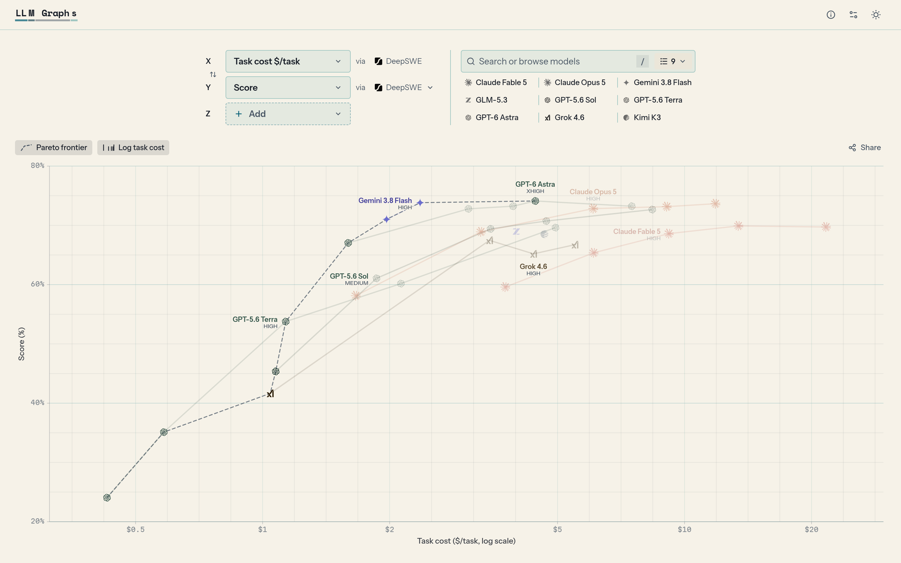
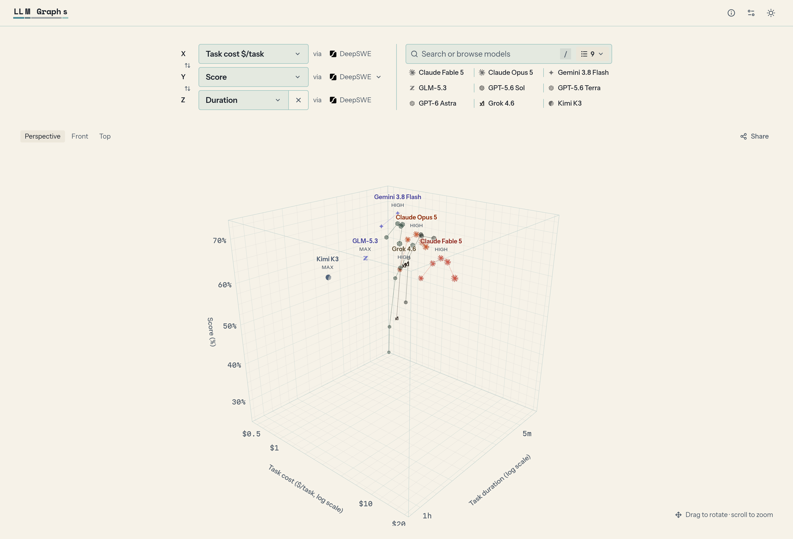
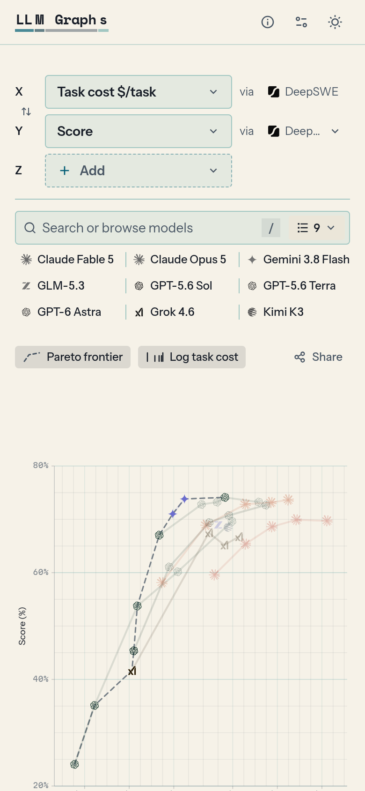
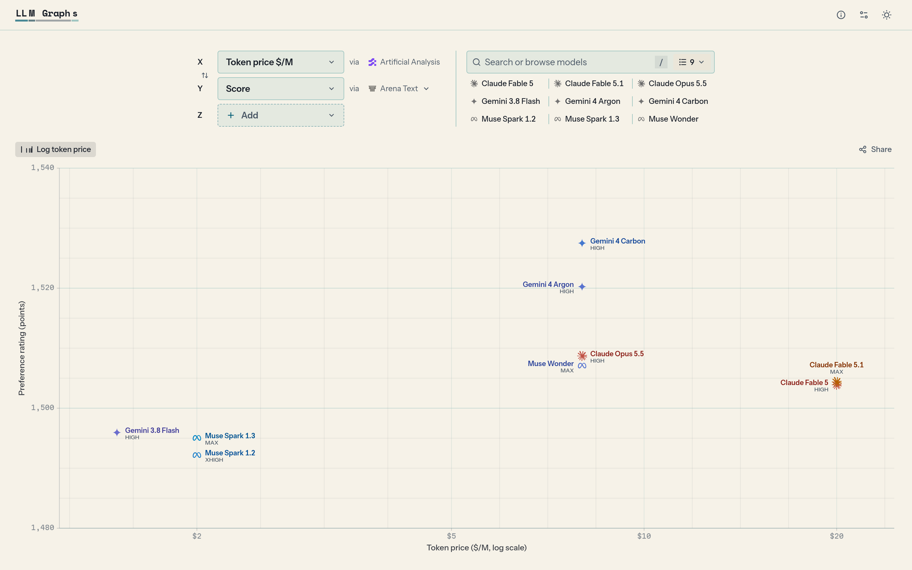

# LLM Graphs

**Every LLM leaderboard, plotted on one chart.**

[**Open LLM Graphs →**](https://llm-graphs.jr7.dev)

 

<a href="https://llm-graphs.jr7.dev/?x=cost&y=score">
  <picture>
    <source media="(prefers-color-scheme: dark)" srcset="images/chart-dark.png" />
    
  </picture>
</a>

## Why

I just want a calm way to find out which model is good at what, without digging through ten different sites and countless tables and graphs.

Every leaderboard publishes its own slice of the picture. One has coding scores, another task cost, another speed or human preference. Answering _"which model gives me the best coding score per dollar?"_ shouldn't mean opening all of them and doing the math yourself.

So LLM Graphs pulls those sources into one place and plots them against each other, for just the models you care about.

## What you can do

<table>
  <tr>
    <td width="50%" valign="top">
      <b>📈 Compare any two metrics</b> 
      Pick an X and Y axis (score, task cost, token price, speed, duration, context length…) and a benchmark for each.
    </td>
    <td width="50%" valign="top">
      <b>🧊 Add a third axis</b> 
      Set a Z metric and the chart becomes a cube you can rotate, with front and top views.
    </td>
  </tr>
  <tr>
    <td width="50%" valign="top">
      <b>🏆 See the Pareto frontier</b> 
      The models no other model beats on every axis are joined by a dashed line, so the best-value picks stand out.
    </td>
    <td width="50%" valign="top">
      <b>🧠 Reasoning levels kept apart</b> 
      Each effort setting (low, high, max…) is its own point, and one model's settings are joined into a curve.
    </td>
  </tr>
  <tr>
    <td width="50%" valign="top">
      <b>🔗 Share, export, download</b> 
      Every chart lives in its URL. Copy the link, save a PNG, or download the data as CSV.
    </td>
    <td width="50%" valign="top">
      <b>🔎 Sources on every point</b> 
      Each axis and tooltip names its benchmark and links to it, with the version, harness and caveats.
    </td>
  </tr>
  <tr>
    <td width="50%" valign="top">
      <b>📱 Works on your phone</b> 
      The full chart and controls fit a mobile screen.
    </td>
    <td width="50%" valign="top">
      <b>🌗 Light and dark</b> 
      Follows your system theme, or pick one.
    </td>
  </tr>
</table>

<table>
  <tr>
    <td width="62%">
      
      
Score, cost and duration on DeepSWE, in 3D

    </td>
    <td width="38%">
      
      
On a phone

    </td>
  </tr>
</table>

## Try these

| Question                                                         | Chart                                                                                             |
| ---------------------------------------------------------------- | ------------------------------------------------------------------------------------------------- |
| Which coding model gives the most for its cost?                  | [Score vs task cost on SWE-bench Verified](https://llm-graphs.jr7.dev/?x=cost&y=score&ySource=sweBench) |
| Do people prefer the expensive models?                           | [Arena rating vs token price](https://llm-graphs.jr7.dev/?x=price&y=score&ySource=arena)          |
| What's the tradeoff between quality, cost and speed on agent work? | [DeepSWE score, cost and duration in 3D](https://llm-graphs.jr7.dev/?x=cost&y=score&z=duration&ySource=deepswe) |
| How long a task can a model handle?                              | [METR task horizon vs token price](https://llm-graphs.jr7.dev/?x=price&y=score&ySource=metr)            |

## Where the data comes from

| Source                                                                                                                                          | What it adds                                              |
| ----------------------------------------------------------------------------------------------------------------------------------------------- | --------------------------------------------------------- |
| [Artificial Analysis](https://artificialanalysis.ai/)                                                                                           | Intelligence Index, task cost, token prices, output speed |
| [DeepSWE](https://deepswe.datacurve.ai/)                                                                                                        | Agentic coding scores, task cost, task duration           |
| [SWE-bench Verified](https://www.swebench.com/)                                                                                                 | Coding scores, task cost                                  |
| [Terminal-Bench 4.0](https://www.tbench.ai/leaderboard/terminal-bench/4.0) and [Terminal-Bench Science](https://www.terminal-bench-science.ai/) | Terminal task scores, task cost, task duration            |
| [CursorBench](https://cursor.com/evals)                                                                                                         | Coding scores in Cursor, task cost                        |
| [FrontierCode](https://cognition.com/frontiercode)                                                                                              | Coding scores, task cost                                  |
| [LiveCodeBench](https://livecodebench.github.io/leaderboard.html)                                                                               | Competitive programming scores                            |
| [METR](https://metr.org/time-horizons/)                                                                                                         | Task horizon, average task score                          |
| [ARC Prize · ARC-AGI-2](https://arcprize.org/leaderboard)                                                                                       | Reasoning scores, task cost                               |
| [AutomationBench](https://zapier.com/benchmarks)                                                                                                | Workflow automation scores, task cost                     |
| [Arena Text](https://arena.ai/leaderboard/text)                                                                                                 | Human preference ratings, vote counts                     |
| [models.dev](https://models.dev/)                                                                                                               | Model catalog, context length, the lab's own token prices |

Data refreshes automatically from each source.

### Honest numbers

- **No mixing.** A score from one benchmark is never blended with another's.
- **No guessing.** Task cost is what the benchmark reported, never derived from token prices. An unknown reasoning setting stays unknown.
- **No hidden context.** Every number links back to where it came from.

The exact meaning of terms like _score_, _task cost_ and _task horizon_ is in [CONTEXT.md](../CONTEXT.md).

## For AI agents

Ask your assistant for a chart and it can build the link for you. [`/llms.txt`](https://llm-graphs.jr7.dev/llms.txt) explains how chart links work and lists every metric, source and model id. An agent that requests any chart link with `Accept: text/markdown` gets that chart described in words.

## Contributing

Want to run it locally or add a benchmark? See [CONTRIBUTING.md](CONTRIBUTING.md).
