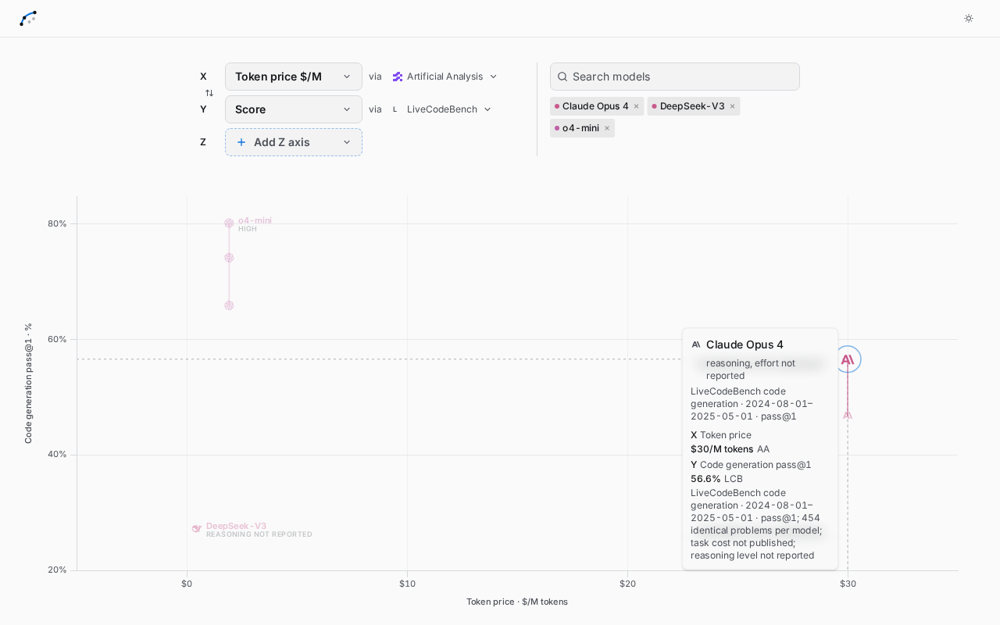
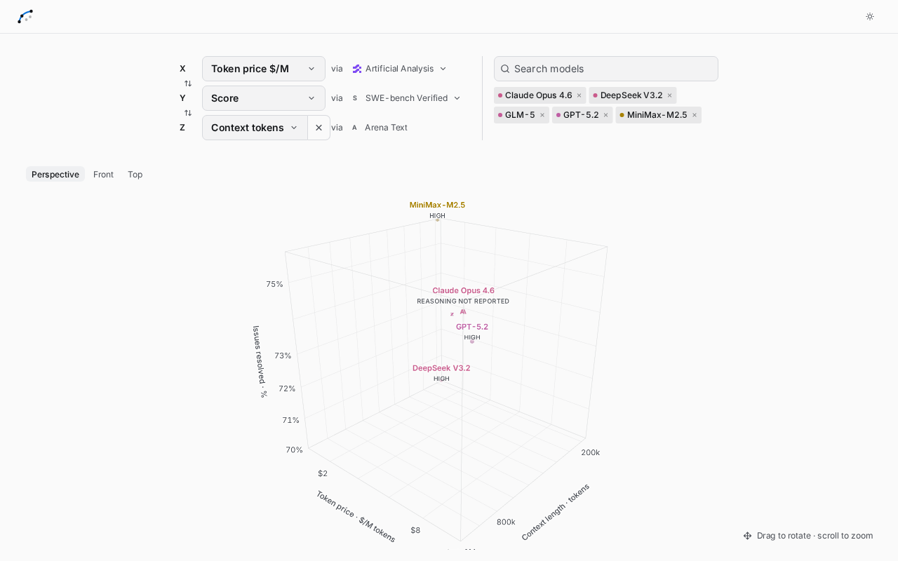

# Coding benchmark additions

Adds two live coding score providers through the existing provider registry and cache. Each refreshes on the next request after its cache is six hours old; a failed refresh preserves the last good payload. Runtime results are fetched upstream; committed JSON fixtures are test snapshots.

## SWE-bench Verified

- [Official leaderboard](https://www.swebench.com/) and [first-party JSON feed](https://raw.githubusercontent.com/SWE-bench/swe-bench.github.io/master/data/leaderboards.json).
- Imports the Verified board's mini-SWE-agent **2.0.0**, single-attempt runs only: **13 configurations**, **12 usable task costs**, no dropped rows. Pins the agent version so older harnesses and other SWE-bench datasets are not mixed.
- Uses published issues-resolved percentages. Task cost requires 500 nonnegative per-instance spending records, agreement with the published total, and agreement with the published average. GPT 5.2 Codex's row lacks per-instance records, so its cost is unavailable while its score remains usable. Zero or warned spending is unavailable.
- Keeps explicit model tags, reasoning effort, run identity and agent configuration. Unknown reasoning settings remain unreported. Duplicate run IDs fail before malformed observations can hide them.
- This pinned feed's runs are dated February 2026; it does not supply current GPT-6/Opus-5.5 results.

## LiveCodeBench

- [Official leaderboard](https://livecodebench.github.io/leaderboard.html), [published code-generation results](https://livecodebench.github.io/performances_generation.json), and [leaderboard implementation](https://github.com/LiveCodeBench/livecodebench.github.io/blob/main/build/leaderboard.html).
- Imports **28 configurations** over the leaderboard's published default **2024-08-01–2025-05-01** window: **454 identical problems per model**, no dropped models. Computes the question-weighted mean of published pass@1 percentages and matches the table's one-decimal rounding.
- Requires complete, identical problem coverage; malformed or missing measurements exclude the entire affected model. Duplicate model/problem identities and conflicting problem metadata fail refresh. The pinned date window and question count cannot change silently.
- Preserves dated model identities and explicit thinking/non-thinking/effort labels; contradicting labels refuse the configuration match. Endpoint aliases use the benchmark's explicit versioned model name. The feed's cutoff field is not treated as a model release date.
- Task costs and runtimes are not published and stay unavailable. Source switching recovers to a usable token-price comparison, with pricing attributed to its own provider. Window, coverage and absent costs appear in point details. This feed has older model coverage; no newer scores are substituted.

## Validation

Both adapters were smoke-tested against their live upstream feeds. All **115 tests**, typecheck, type-aware oxlint, oxfmt checks and the production build pass. Parser regressions cover cost coverage, out-of-range scores, duplicate identities, dataset windows, missing problems, contradictory reasoning labels and preserving unknown effort.

The fixture graph matrix and live collaborative-browser audit each check **925 distinct 2D/3D metric/source combinations**:

- 420 meaningful comparisons.
- 129 unavailable-measurement states.
- 376 states without safe model-configuration matches.
- Zero constant default axes and zero browser rendering failures.

The browser audit checks mounted point counts, native axis labels and clipping, animation frames, WebGL painted pixels, projected markers, finite geometry and distinct scene coordinates. Existing sources used the app's latest good cached data; their actual fetch dates are recorded in the browser report.

Additional computer-use interactions verified switching from SWE-bench to LiveCodeBench (task cost recovers to token price), keyboard point selection and its provenance readout, adding a context-length Z axis, camera presets, and selecting the new sources from the mobile menu. All eleven source choices fit within the 390×844 viewport.

Evidence: [fixture matrix](coding-bench-graph-data-results.jsonl), [live browser report](coding-bench-browser-results.jsonl).

